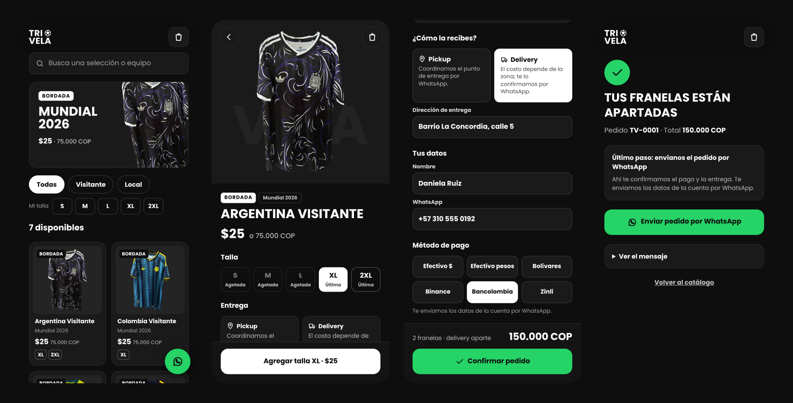
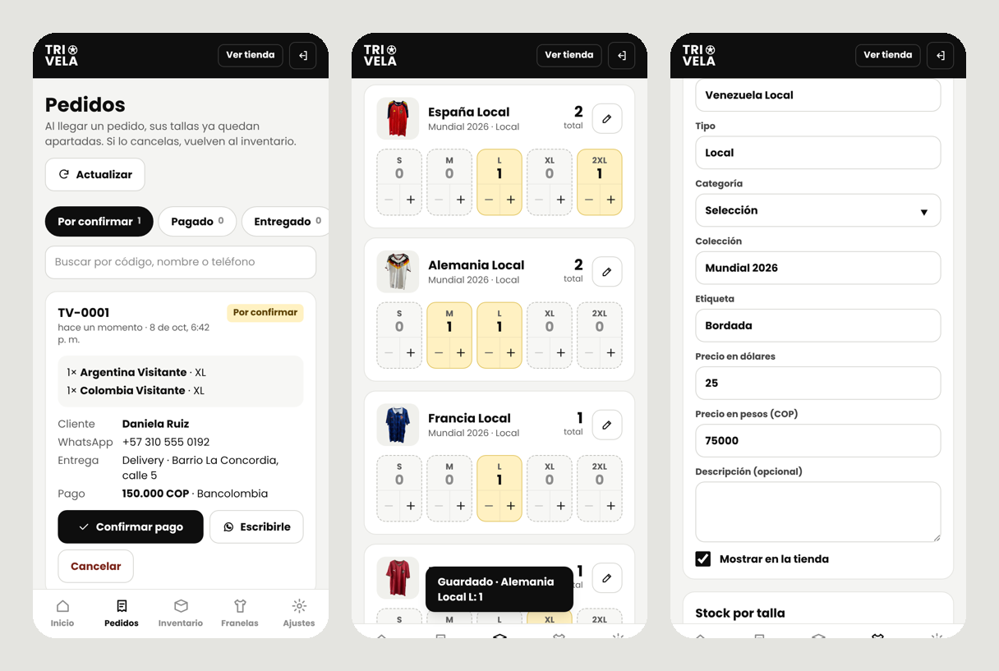
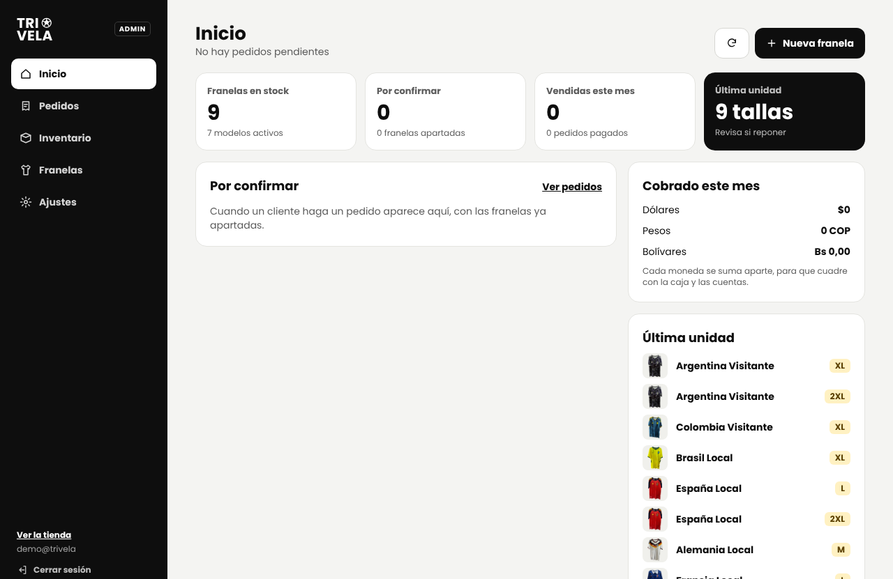

# Trivela · Tienda de franelas de fútbol

App web instalable (PWA) para **Trivela**, una tienda de franelas de fútbol bordadas que vendía por Instagram y
llevaba el inventario en Excel. Reemplaza las hojas de cálculo y la atención uno a uno por:

- **Una tienda** donde el cliente ve en tiempo real qué franela hay y en qué talla, arma su pedido y lo envía listo por WhatsApp.
- **Un panel de administración** donde el dueño confirma pagos, controla el stock por talla y carga franelas nuevas desde el teléfono.



## Qué resuelve

| Antes | Con la app |
| --- | --- |
| El cliente escribía para preguntar "¿hay en M?" | Ve el stock por talla y filtra por su talla |
| El dueño copiaba cada pedido a mano | El pedido llega armado por WhatsApp con código, tallas, total y datos de entrega |
| El Excel se desfasaba con las ventas | Al pedir, la talla se aparta sola; al cancelar, vuelve al inventario |
| Cobros en varias monedas mezclados | Cada pedido guarda su total en USD, COP y Bs, y el panel suma cada moneda aparte |

## Funcionalidades

**Tienda (cliente)**
- Catálogo con búsqueda, filtro por tipo (local, visitante) y por talla disponible.
- Detalle con tallas agotadas, aviso de "última unidad" y contacto directo si falta una talla.
- Carrito que no deja pedir más unidades de las que existen.
- Checkout con **pickup o delivery** y 6 métodos de pago (efectivo en dólares o pesos, bolívares, Binance, Bancolombia, Zinli). El total se muestra en la moneda del método elegido.
- Envío del pedido por WhatsApp con el mensaje ya redactado.
- Las tallas quedan apartadas un tiempo configurable (24 h por defecto). Si el pago no se confirma, se liberan solas para otros clientes.
- Vista previa con imagen al compartir el link en WhatsApp, Instagram o Facebook.
- Instalable en el teléfono, con caché de fotos para cargar rápido con datos móviles.

**Panel (dueño)**
- Aviso de pedido nuevo sin recargar: sonido, mensaje en pantalla, contador en "Pedidos", en el título de la pestaña y notificación del sistema.
- Resumen: pedidos por confirmar, tallas en su última unidad, unidades vendidas y lo cobrado del mes por moneda.
- Pedidos con estados (por confirmar → pagado → entregado / cancelado), búsqueda y contacto al cliente por WhatsApp.
- Inventario por talla con + / − que se guarda solo.
- Alta y edición de franelas con foto, precios en USD y COP, y opción de ocultarlas.
- Ajustes: número de WhatsApp, tasa del día, información de entrega y métodos de pago.





## Stack

- **Frontend:** React 18, TypeScript, Vite, Tailwind CSS, React Router
- **Backend:** Supabase (PostgreSQL, Auth, Storage), sin servidor propio
- **PWA:** vite-plugin-pwa (Workbox)
- **Hosting:** Vercel

## Decisiones técnicas

- **La lógica de negocio vive en la base de datos.** Crear un pedido es una función de PostgreSQL (`create_order`) que valida el método de pago, bloquea las filas de stock (`SELECT … FOR UPDATE`), descuenta las tallas y calcula los totales en una sola transacción. Así dos clientes no pueden comprar la última unidad al mismo tiempo, y el precio nunca viene del navegador.
- **Seguridad con Row Level Security.** El público solo lee franelas activas y stock; no puede leer ni escribir pedidos directamente. Solo los correos de la tabla `admins` pueden gestionar datos, y cancelar un pedido (que devuelve el stock) pasa por otra función que verifica el permiso.
- **Apartados que vencen sin servidor ni cron.** `release_expired_orders()` cancela los pedidos sin pagar más viejos que el límite y devuelve el stock. Se ejecuta antes de leer el catálogo, al crear un pedido y desde el panel, con `FOR UPDATE SKIP LOCKED` para que dos ejecuciones simultáneas no se pisen.
- **Numeración sin huecos.** El código `TV-0001` se asigna al final de la transacción, así un pedido rechazado no consume número.
- **Modo demo.** Sin credenciales de Supabase, la app usa una implementación local (`demoApi`) con la misma interfaz (`Api`), lo que permite enseñarla o desarrollar sin backend.
- **Pensada para el teléfono.** La tienda es mobile-first y el panel tiene navegación inferior en móvil y lateral en escritorio.

## Estructura

```
supabase/schema.sql      tablas, RLS, funciones create_order y set_order_status, bucket de fotos
supabase/seed.sql        catálogo inicial
supabase/actualizaciones/ cambios de base de datos para proyectos ya creados
src/lib/                 tipos, monedas, mensaje de WhatsApp, carrito, supabaseApi / demoApi
src/pages/shop/          Catálogo, Detalle, Carrito, Pedido, Confirmación
src/pages/admin/         Login, Inicio, Pedidos, Inventario, Franelas, Ajustes
```

## Correrlo en local

```bash
npm install
npm run dev
```

Sin `.env.local` arranca en modo demo (panel en `/admin`, contraseña `trivela2026`).

### Conectar Supabase

1. Crear un proyecto en [supabase.com](https://supabase.com).
2. En **SQL Editor**, correr `supabase/schema.sql` y luego `supabase/seed.sql`.
3. **Authentication → Users → Add user**: crear el usuario administrador (con *Auto Confirm User*).
4. Darle permiso: `insert into public.admins (email) values ('correo@ejemplo.com');`
5. **Authentication → Sign In / Providers**: desactivar *Allow new users to sign up*.
6. Copiar `.env.example` como `.env.local` y pegar la *Project URL* y la clave *anon / publishable*.

### Publicar en Vercel

Importar el repositorio en Vercel y agregar `VITE_SUPABASE_URL` y `VITE_SUPABASE_ANON_KEY` en *Environment Variables*.
El archivo `vercel.json` ya redirige todas las rutas a la app.

## Comandos

| Comando | Qué hace |
| --- | --- |
| `npm run dev` | Desarrollo en local |
| `npm run build` | Versión de producción en `dist/` |
| `npm run build:demo` | Versión demo sin backend, con rutas `#/` |

## Próximos pasos

Lista de espera por talla, venta directa en el local, historial de movimientos de stock, importación desde Excel,
varias fotos por franela y tallas de niño.

---

Desarrollado por **Carlos Marval** · Estudiante de la UNET
